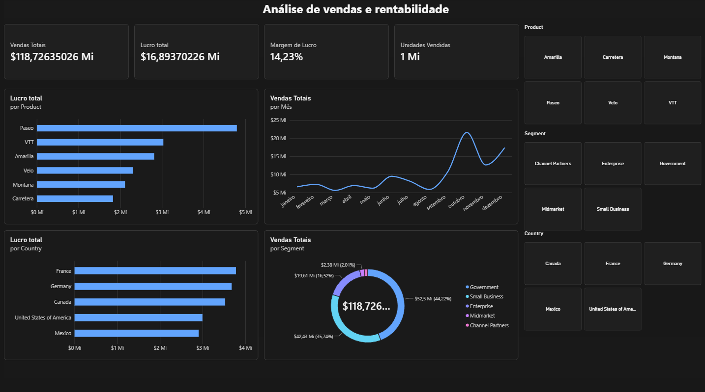

# Análise de Vendas e Lucratividade

Dashboard desenvolvido no Power BI para analisar vendas, lucro e desempenho comercial.

## Introdução

O objetivo deste projeto é desenvolver um dashboard interativo no Power BI para visualizar e analisar indicadores de vendas e rentabilidade, transformando dados em informações que possam apoiar a tomada de decisões empresariais.

Por meio de indicadores e visualizações, o dashboard permite explorar o desempenho comercial sob diferentes perspectivas, incluindo produtos, países, segmentos de clientes e períodos, facilitando a identificação de padrões e oportunidades de melhoria.

Os dados utilizados foram obtidos da base Financial Sample Excel workbook e são utilizados para fins educacionais e de demonstração. A origem e a natureza dos dados devem ser confirmadas na documentação da base.

## Indicadores analisados

- Vendas totais
- Lucro total
- Margem de lucro
- Unidades vendidas
- Lucro por produto e país
- Vendas por mês e segmento

## Ferramentas utilizadas

- Microsoft Power BI
- Análise e visualização de dados
- Base de dados Financial Sample Excel workbook

## Arquivos do projeto

O repositório incluirá o dashboard em formato `.pbix`, as imagens para visualização rápida e um relatório com as principais conclusões da análise.
